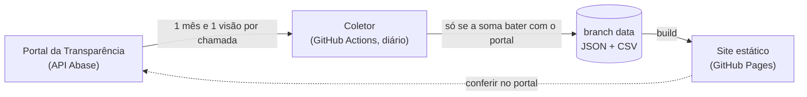

<div align="center">

<picture>
  <source media="(prefers-color-scheme: dark)" srcset="docs/brand/gastometro-rolante/assets/gastometro-rolante/mark-dark.svg">
  
</picture>

# Gastômetro Rolante

**Quanto a Prefeitura de Rolante/RS gasta e em quê, com dado real e diário do Portal da Transparência.**

[](https://filipesfbr.github.io/gastometro-rolante/)

[](https://github.com/filipesfbr/gastometro-rolante/actions/workflows/ci.yml)


[](LICENSE)

</div>

---

## O que é

Um site que mostra quanto a Prefeitura de Rolante gastou no ano e para onde foi o dinheiro: por área (saúde,
educação…), por secretaria, por tipo de gasto e pela origem do recurso. **Todos os números vêm do
[Portal da Transparência da Prefeitura de Rolante](https://transparencia.abase.com.br/home/apvqyIT7vjY=)**,
e cada um tem link para conferir no próprio portal. Nada de estimativa, projeção ou contador por segundo, e
nenhum nome de pessoa ou empresa.

É o par do [Impostômetro Rolante](https://github.com/filipesfbr/impostometro-rolante): um mostra o que entra,
o outro mostra o que sai. Site independente, sem vínculo com a prefeitura. As regras de onde vem cada número
estão em [`docs/fonte-de-verdade.md`](docs/fonte-de-verdade.md) (R1–R9).

## O que tem

- **Para onde foram os R$ do ano:** pago no ano, por habitante, variação contra o mesmo período do ano
  anterior e a barra «de cada R$ 100 pagos».
- **Do compromisso ao pagamento:** empenhado → liquidado → pago, e quanto falta pagar.
- **Folha de pagamento:** custo do ano (empenhado), pago, por habitante, comparação com os dois anos
  anteriores e tabela mês a mês. É a soma dos elementos de pessoal da Portaria 163/2001 (`config/folha.json`).
- **Para onde vai o dinheiro:** mapa de blocos por área (função), secretaria, tipo de gasto (elemento) e
  recurso vinculado, com o mês a mês de cada um. Secretaria e recurso não se comparam com o ano anterior,
  porque os nomes mudam.
- **Mês a mês** e **acumulado** do ano.
- **De onde vêm os números:** validação da última coleta, dados para baixar (JSON e CSV) e o histórico de
  alterações feitas pelo portal em meses já coletados.

O mês de cada gasto é o **mês do empenho**: liquidado e pago são o estado atual desses empenhos, por isso
meses anteriores continuam crescendo enquanto são pagos.

## Como funciona

Sem servidor e sem banco:



1. Todo dia, às 06:47 de Brasília, o coletor (Node + TypeScript, sem dependências) lê os empenhos do portal
   nas 4 visões: função, elemento, órgão e recurso vinculado.
2. Para cada mês e cada visão, empenhado, liquidado e pago somados têm de bater ao centavo com os cartões do
   portal (R2); se algum não bater, nada é publicado e o site continua na coleta anterior.
3. Os empenhos são somados por dia e área **em memória**, sem credor, fornecedor nem histórico do empenho (R8).
   Mudanças de empenhado e quedas de pago em meses já coletados entram no histórico (R5).
4. O resultado vai para a branch `data` (histórico público dos snapshots, R3) e o site é publicado no
   GitHub Pages.

| Pasta | O quê |
|---|---|
| `coletor/` | coleta, validação, agregação, diff e o resumo que o site lê (`site.json`) |
| `config/` | `fonte.json` (endereço, token e entidade do portal), `folha.json` (elementos de pessoal que formam a folha, R6) e `populacao-ibge.json` (última estimativa do IBGE, usada quando a API do IBGE não responde) |
| `site/` | a página (única, navegação por âncoras), em Vite + React |
| `data/` | **não fica na `main`**: é a branch `data`, gerada pelo coletor |
| `docs/` | regras da fonte de verdade, o plano do projeto e o pacote de marca (`docs/brand/`) |

## Rodar local

Node 24 (roda TypeScript direto, sem build do coletor).

```bash
npm ci
npm run coletar     # ~15 min (~115 chamadas, 1 a cada 2 s); grava em ./data
npm run dev         # http://localhost:5173
```

Para usar os dados publicados em vez de coletar: `git worktree add data origin/data`.

Antes de abrir PR (é o que o CI roda):

```bash
npm run lint && npm run build && npm test
```

Valores de referência para conferir uma coleta (portal em 27/10/2026; pago e liquidado crescem com o tempo):
2026 até 27/10 empenhado R$ 124.211.165,88, liquidado R$ 102.252.404,86, pago R$ 100.981.098,46; set/2026
963 empenhos.

## Dados

Na branch [`data`](../../tree/data), todos em centavos inteiros, datas `AAAA-MM-DD`:

| Arquivo | Conteúdo |
|---|---|
| `despesas/AAAA-{funcao,elemento,orgao,vinculo}.json` · `.csv` | empenhado, liquidado e pago somados por dia e área (sem nomes) |
| `totais/AAAA.json` | cartões do portal: empenhado, liquidado e pago no ano e por mês |
| `site.json` | resumo que a página lê |
| `codigos.json` | nome da área → código do portal, para o link "conferir no portal" |
| `historico-alteracoes.json` | mudanças em meses já coletados (R5) |
| `populacao.json` | estimativas do IBGE |
| `manifest.json` | data da coleta, validação por mês e visão, e SHA-256 de cada arquivo |

## Identidade visual

Família Rolante, par do Impostômetro: a gota com um cifrão sobre duas ondas, fonte Inter, fundo `#faf8f4`,
tinta `#26221d` e um único acento, `#b4622f` (âmbar `#d98a52` no tema escuro). Sem sombras nem gradientes.
Os tokens ficam em [`site/src/styles/tokens.css`](site/src/styles/tokens.css), a marca entra pelos
componentes de [`site/src/components/brand/`](site/src/components/brand/), e a especificação e os arquivos
da marca estão em [`docs/brand/`](docs/brand/README.md).

## Fluxo de trabalho

Mesmo pipeline do [`workflow-test`](https://github.com/filipesfbr/workflow-test) (ler o README de lá
antes de mudar qualquer workflow):

```
PR → develop (squash) → bump automático da versão na develop
develop → main (PR, merge commit) → tag + Release → sync main → develop → deploy
```

| Workflow | Quando | O quê |
|---|---|---|
| `ci.yml` | push/PR | lint, build, test |
| `bump.yml` | push na `develop` | 1 bump de versão por ciclo (minor/major: rodar na mão com `kind`) |
| `release.yml` | push na `main` | tag `vX.Y.Z` + Release; sincroniza `main → develop` |
| `deploy.yml` | push na `main`, chamado pela coleta, manual | build com a branch `data` e publica no Pages |
| `coleta.yml` | todo dia 09:47 UTC, manual | coleta → conferência R8 → commit na `data` → deploy |

### Rodar a coleta na mão

Pelo GitHub: **Actions → Coleta diária → Run workflow** (branch `main`). Ou pelo terminal:

```bash
gh workflow run coleta.yml --ref main
gh run watch   # acompanha até terminar
```

A coleta leva cerca de 15 minutos, grava na branch `data` e publica o site em seguida. Se algum mês
não bater com o portal, nada é publicado e o site continua na coleta anterior.

O código vai por PR; os dados vão direto na `data`, pela coleta. Assim o histórico de releases fica
só com mudança de código, e o da `data` é o registro diário do que o portal mostrava.

## Configuração do repositório

1. Empurre a `main` primeiro (a primeira branch vira a default).
2. Rode `scripts/bootstrap-repo.sh filipesfbr/gastometro-rolante`: cria a `develop`, ajusta merge
   (`delete_branch_on_merge: false`, sem rebase), cria os rulesets (`main`, `develop`, `data`) e liga
   o GitHub Pages pelo Actions.
3. Rode a primeira coleta na mão: `gh workflow run coleta.yml --ref main`.

## Licença e créditos

Licença **MIT**, veja [`LICENSE`](LICENSE). Os dados são públicos e pertencem à fonte: Portal da Transparência
da Prefeitura de Rolante e IBGE.
